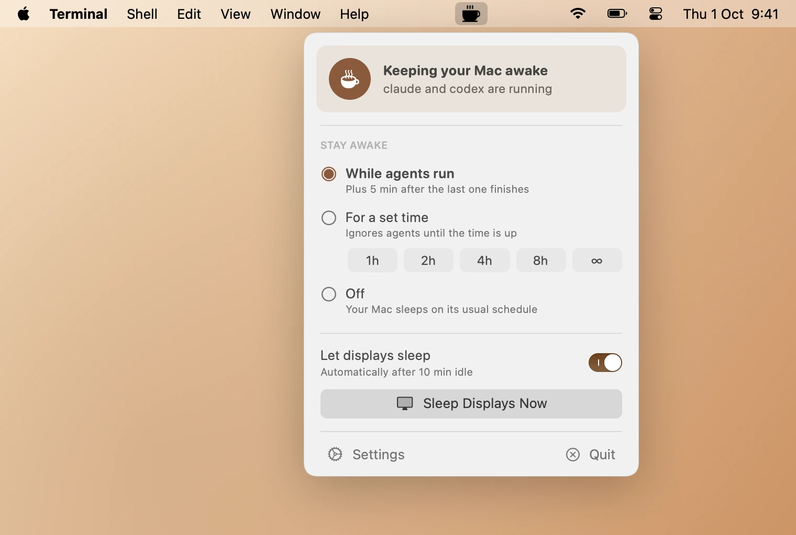

# Cappucino

A macOS menu bar app that keeps your Mac awake while AI agents work, and still lets your displays sleep so OLED panels don't burn in.


<picture>
  <source media="(prefers-color-scheme: dark)" srcset="docs/popover-agents-dark.webp">
  
</picture>

## Features

- **System awake, displays asleep.** Holds a `PreventUserIdleSystemSleep` power assertion (the same thing `caffeinate -i` uses). The Mac won't idle-sleep, but your normal display-sleep timer still applies.
- **Auto mode.** Detects running agent CLIs (`claude`, `codex`, `gemini`, `aider`, `opencode`, `amp`, `goose`, `cursor-agent`, `crush`, `qwen`, `droid`) and keeps the Mac awake only while they run. You can edit the list in Settings.
- **Grace period.** Stays awake for a few minutes after the last agent exits, in case you queue up the next task (none/5/10/15/30 min).
- **Clear status.** The popover says whether the Mac is being kept awake and why (which agents are running), or when it will sleep if not.
- **Timer.** Keep awake for 1h, 2h, 4h, 8h, or indefinitely, whether or not agents are running. A countdown appears in the menu bar.
- **Let displays sleep** (on by default). Turn it off to also keep the displays on while the Mac is kept awake.
- **Sleep Displays Now.** Turns displays off immediately while agents keep working.
- **Burn-in warnings.** Shows your display-sleep setting, warns if it's set to never, and lists any other app (a video player, a browser tab, another keep-awake tool) that is keeping the displays on.
- **Launch at login.**
- **Nothing to configure.** No accounts, no network access, no root.

## Requirements

- macOS 14.0+

## Building it yourself

There are no prebuilt downloads: you build Cappucino from source. You don't need an Apple Developer account. Dev dependencies:

- Xcode 26+, for `swift`, `codesign` and `actool`, which compiles the Icon Composer app icon (the Command Line Tools alone don't include `actool`)
- Optional: `cwebp` (`brew install webp`), only for `make screenshots`

```bash
git clone https://github.com/nicbet/cappucino.git
cd cappucino
make signing-cert   # once: create a local code-signing certificate (see below)
make install        # build the release app and copy it to /Applications
```

The other tasks:

```bash
make bundle    # builds release binary + .app bundle
make run       # builds and launches
```

The screenshots in `docs/` are rendered by the app itself from preset states (`make screenshots`). `make snapshot` renders every state, light and dark, to `.build/snapshots/`.

### Signing certificate

Cappucino isn't signed with an Apple Developer ID. Without a certificate, `make bundle` signs it ad hoc, and an ad-hoc signature is different for every build, so macOS sees each rebuild as a new app. A self-signed certificate gives every build the same identity.

`make signing-cert` runs [`scripts/create-signing-cert.sh`](scripts/create-signing-cert.sh), which:

1. creates a self-signed certificate named "Local App Signing" with `openssl`, valid for 10 years and limited to code signing,
2. imports it with its private key into your login keychain, and lets `codesign` use the key,
3. trusts it for code signing only (macOS asks for your password).

`make bundle` checks for the identity with `security find-identity -v -p codesigning` and signs with it when it is there; otherwise it signs ad hoc and says so. AI Bar and Nocchi use the same "Local App Signing" identity, so you only create it once. To use a different name, pass it to both targets: `make signing-cert SIGNING_IDENTITY="My Signing"` and `make bundle SIGNING_IDENTITY="My Signing"`. On the first signed build, macOS may ask whether `codesign` may use the key: click **Always Allow**. To remove the certificate, delete "Local App Signing" (certificate and key) in Keychain Access.

The app isn't notarized. A copy you build yourself opens normally. If you copy it to another Mac, Gatekeeper blocks it the first time: click **Open Anyway** in System Settings → Privacy & Security, or run `xattr -dr com.apple.quarantine /Applications/Cappucino.app`.

## How It Works

### Keeping awake

macOS has separate assertions for system sleep and display sleep. Cappucino only takes the system one:

| Assertion                     | Cappucino                           | Effect                               |
| ----------------------------- | ----------------------------------- | ------------------------------------ |
| `PreventUserIdleSystemSleep`  | ✅ held                             | Mac stays awake, agents keep running |
| `PreventUserIdleDisplaySleep` | only if "Let displays sleep" is off | Displays stay on too                 |

You can see what Cappucino is doing and why with:

```bash
pmset -g assertions | grep Cappucino
```

### Agent detection

Every 5 seconds Cappucino scans the process table for the configured names. Agents that run through an interpreter (for example `node /opt/homebrew/bin/gemini`) are matched by their script name. Version-named binaries launched through a symlink (like Claude Code's native installer) are matched by `argv[0]`. Names are case-sensitive, so `claude` matches the CLI but not the Claude desktop app.

### Limitations

- **Closing a MacBook lid still sleeps it**, unless it's in clamshell mode with external power and a display. Power assertions can't override lid-close sleep without root (`pmset disablesleep`).
- The display-sleep timeout is a system setting (System Settings → Lock Screen / Displays). Cappucino reads it but doesn't change it.

## License

MIT. Menu bar icons are from [Phosphor Icons](https://phosphoricons.com) (MIT), see [THIRD_PARTY_NOTICES.md](THIRD_PARTY_NOTICES.md).

## Trademarks

Claude and Claude Code are trademarks or registered trademarks of Anthropic, PBC. OpenAI and Codex
are trademarks or registered trademarks of OpenAI. The other agent names listed above are
trademarks of their respective owners. Cappucino is an independent project and is not affiliated
with, endorsed by or sponsored by any of them.
